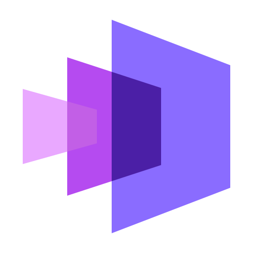
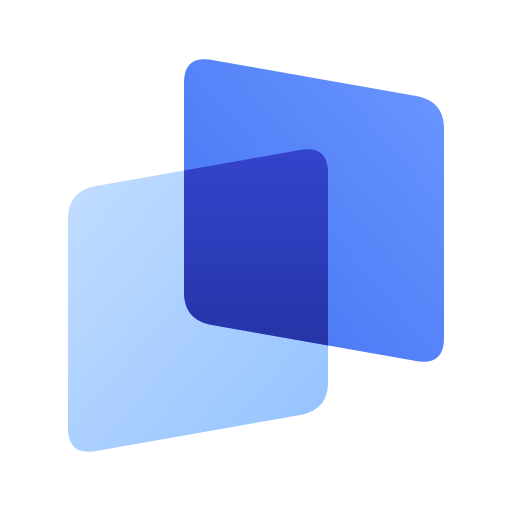
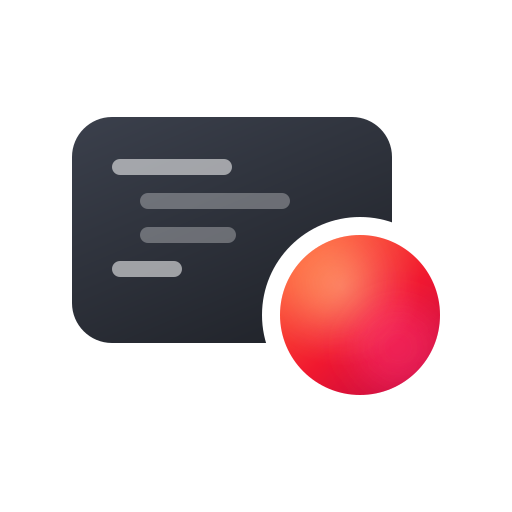

## Hi, I'm Anton

System administrator at NONTON, based in Saint Petersburg. I like writing code and automating routine work, and I'm working toward a DevOps role — currently learning Kubernetes, Terraform, Ansible, Prometheus and Grafana.

### Projects

#### Tools I built for NONTON

-  **[anyscreen](https://github.com/Speedware/anyscreen)** — digital signage managed from a web dashboard. Players for Android TV and the browser, deployed with one command.

-  **[tandem](https://github.com/Speedware/tandem)** — mirrors an application window onto a second monitor on Windows.

-  **[scrlog](https://github.com/Speedware/scrlog)** — a Windows service that records the screen during working hours and cleans up old recordings.

#### Other

-  **[finman](https://github.com/Speedware/finman)** — personal finance tracker with accounts, categories, transfers and a dashboard of charts.

-  **[calsync](https://github.com/Speedware/calsync)** — turns the university class schedule into a calendar subscription that stays up to date.

 

<a href="https://speedware.tech"><picture><source media="(prefers-color-scheme: dark)" srcset="assets/speedware-site-white.svg"></picture></a>
